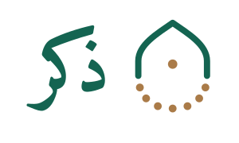
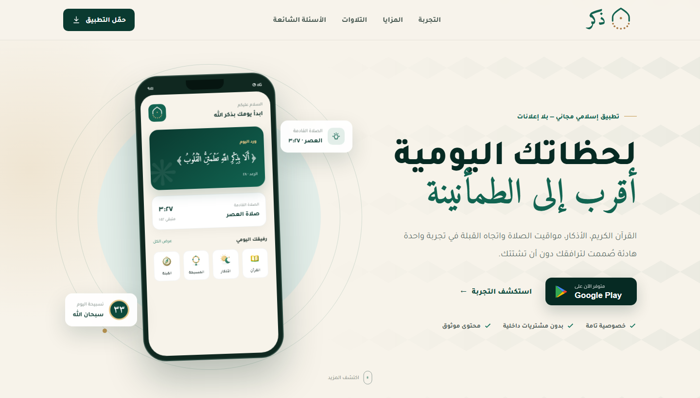

<div dir="rtl" align="center">



# ذِكر — رفيقك اليومي

### القرآن الكريم، الأذكار، مواقيت الصلاة واتجاه القبلة في تجربة واحدة هادئة

[](https://eslamsaleeh98.github.io/Zekr-App/)
[](https://play.google.com/store/apps/details?id=com.zekrapp.islamic)
[](#-لماذا-ذِكر)

تطبيق إسلامي مجاني صُمّم ليجعل الوصول إلى القرآن والذِكر أسهل، بواجهة عربية واضحة تحترم وقت المستخدم وخصوصيته.

</div>

---

## ✨ لماذا «ذِكر»؟

- **تجربة هادئة:** تصميم واضح بعيد عن العناصر المشتتة.
- **مجاني بالكامل:** دون اشتراكات أو مشتريات داخل التطبيق.
- **بدون إعلانات تجارية:** مساحة للذِكر، لا للإعلانات.
- **خصوصية أولًا:** لا بيع لبيانات المستخدم أو تتبع إعلاني مزعج.
- **واجهة عربية متجاوبة:** تجربة مناسبة للهواتف والشاشات المختلفة.

## 🌿 المزايا

| الميزة | التفاصيل |
|---|---|
| 📖 القرآن الكريم | تصفح المصحف بالرسم العثماني ومتابعة الورد اليومي |
| 🎧 التلاوات | الاستماع إلى تلاوات مختارة عبر مشغّل بسيط وواضح |
| 🤲 الأذكار والأدعية | أذكار الصباح والمساء والنوم وأدعية المناسبات |
| 🕰️ مواقيت الصلاة | عرض المواقيت والصلاة القادمة بصورة مباشرة |
| 🧭 اتجاه القبلة | بوصلة سهلة لمعرفة اتجاه القبلة |
| 📿 المسبحة | عدّاد تسبيح يساعد على المداومة |

## 🖼️ لمحة من التجربة

<div align="center">
  
</div>

> صفحة الهبوط تعرض معاينات تفاعلية للقرآن، مواقيت الصلاة، الأذكار ومشغّل التلاوة.

## 🚀 تشغيل صفحة الهبوط محليًا

لا تحتاج الصفحة إلى تثبيت حزم أو أدوات بناء. شغّل أي خادم ملفات ثابتة داخل مجلد المشروع، ثم افتح الصفحة في المتصفح.

```bash
npx serve .
```

أو افتح `index.html` مباشرة إذا كان المتصفح يسمح بتشغيل الملفات المحلية المطلوبة.

## 🧱 بنية المشروع

```text
Zekr-App/
├── assets/              # الشعارات، الأيقونات، الصور والملفات الصوتية
├── css/style.css        # التصميم المتجاوب للصفحة
├── js/main.js           # التفاعلات ومشغّل التلاوة
├── index.html           # صفحة الهبوط الرئيسية
├── privacy.html         # سياسة الخصوصية
└── terms.html           # شروط الاستخدام
```

## 🛡️ الخصوصية والشروط

- [سياسة الخصوصية](https://eslamsaleeh98.github.io/Zekr-App/privacy.html)
- [شروط الاستخدام](https://eslamsaleeh98.github.io/Zekr-App/terms.html)

## 📲 التحميل

النسخة الرسمية متاحة لأجهزة Android عبر Google Play:

**[تحميل تطبيق ذِكر من Google Play](https://play.google.com/store/apps/details?id=com.zekrapp.islamic)**

معرّف الحزمة: `com.zekrapp.islamic`

---

<div align="center">

**صُنع بمحبة، ابتغاء مرضاة الله**

إذا أعجبك المشروع، يمكنك دعمه بإضافة ⭐ للمستودع ومشاركة التطبيق مع من تحب.

</div>
